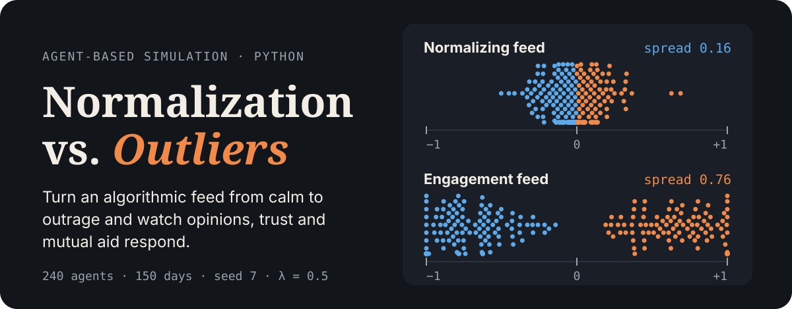
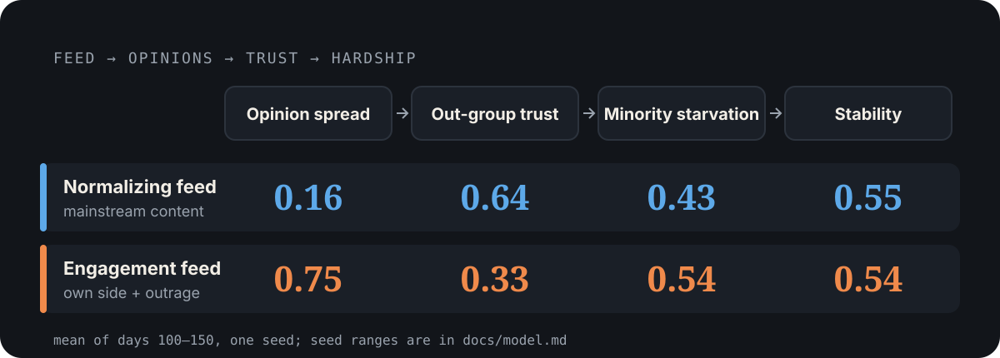
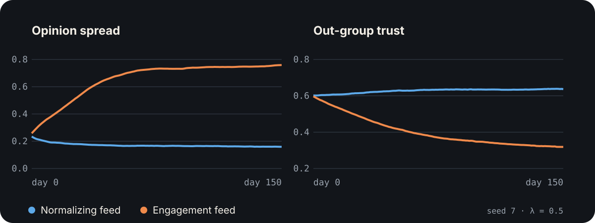

<p align="center">
  
</p>

A small, hackable agent-based simulation of how an **algorithmic feed** and **outlier movements** (social justice groups, political extremists, environmentalists, anti-vax misinformation, religious cults) interact with a simple resource economy. One dial, **lambda**, sets how much of each agent's attention goes to the feed instead of their peers. The feed either shows mainstream content (*normalizing*) or content a bit more extreme than the viewer, with outrage about the other side (*engagement*).

It is a **teaching toy**, not a prediction engine: built for iterative experiments and Primer-style explainers where you fix a few dials and narrate the trajectories.

## What the dial does

<p align="center">
  
</p>

The causal chain the model encodes: a **normalizing feed** keeps opinion distances small, so agents give more and refuse less, trust and aid grow, and starvation falls. An **engagement feed** pushes two camps apart and erodes out-group trust, so help across the divide stops, joint disaster responses fail, and recruitment into the fringe groups speeds up.

<p align="center">
  
</p>

Both runs use the same seed and population; only `--engagement` differs (`python assets/readme/source/build_assets.py` regenerates the figures). Stability barely moves because the minority's built-in income gap dominates it; the hardship shows up in minority starvation and out-group trust.

## Quick start

Python 3.9+:

```bash
pip install -r requirements.txt
```

Run a simulation (CSV and plots in `./outputs/exp1`):

```bash
python -m normalization_sim.run_cli --days 150 --lambda_ 0.15 --minority_share 0.3 --seed 7 --outdir outputs/exp1
```

Try an engagement-optimized feed:

```bash
python -m normalization_sim.run_cli --days 150 --lambda_ 0.15 --engagement 1 --outdir outputs/engage_demo
```

### Interactive dashboard

A Streamlit app puts every dial in a sidebar and draws the results as interactive charts:

```bash
pip install -r requirements-app.txt
streamlit run app.py
```

- **Dashboard**: headline tiles (mean over the last 30 days) and the metrics over time, with disaster days marked.
- **Opinions**: the opinion distribution as a heatmap over time, majority and minority opinions on any day, and outlier group membership.
- **Network**: every agent as a dot, sized by what it has on hand, ringed when starving, colored by opinion, group or majority/minority. Press Play to animate the days, or arrange agents by opinion to watch the population converge or split.
- **Compare A/B**: runs a second scenario with the same seed (by default switching the feed to engagement mode) and shows the two side by side.
- **Data**: the metrics table, a CSV download and the parameters used.

Presets load common starting points. Runs take a few seconds and are cached, so switching views or returning to earlier settings is instant.

## How it works

- **Agents** are split into majority and minority with unequal daily incomes. Resources persist: agents earn, help a neighbor, eat, and carry savings to the next day, with daily good and bad harvest shocks.
- **Opinions** follow a Friedkin–Johnsen model with bounded confidence: agents stay anchored to their initial view and ignore partners (and feed content) too far from their own.
- **Opinions feed back into behavior**: opinion distance changes partner choice, giving, trust and recruitment, so opinions move starvation and stability, not just opinion statistics.
- **Outlier groups** recruit through several close contacts, mostly from agents near their position, and lose members again.
- **Disasters** can only be handled if both opinion camps cooperate, so out-group trust decides whether a joint response works.
- **Metrics** are recorded daily: stability, inequality (Gini), opinion and affiliation diversity, trust (overall, in-group, out-group), starvation (minority, majority, overall), opinion mean and spread, and the share of opinions at the bounds. Output is a `metrics.csv` plus matplotlib plots.

## Measured results

150 days, mean of the last 50 days over seeds 3, 7, 11, 23, 42, 99:

| run | opinion spread | out-group trust | minority starvation | stability |
|---|---|---|---|---|
| `--lambda_ 0` (no feed) | 0.307 | 0.603 | 0.486 | 0.542 |
| `--lambda_ 0.15` (default) | 0.231 | 0.618 | 0.466 | 0.544 |
| `--lambda_ 0.5` | 0.180 | 0.631 | 0.466 | 0.544 |
| `--lambda_ 0.15 --engagement 1` | 0.552 | 0.503 | 0.537 | 0.536 |
| `--lambda_ 0.5 --engagement 1` | 0.735 | 0.336 | 0.564 | 0.533 |

The engagement feed builds echo chambers rather than a society pinned at ±1, and the normalizing feed narrows opinion spread without ever producing consensus. The full tables (seed ranges, group membership, settling times) and caveats are in the [model reference](./docs/model.md#the-feed).

## Dials

The most useful CLI flags (all of them are in the [model reference](./docs/model.md#dials-cli-flags)):

| flag | default | meaning |
|---|---|---|
| `--lambda_` | 0.15 | share of attention on the feed (0..1); the rest goes to peers |
| `--engagement` | 0 | 0 = normalizing feed, 1 = engagement feed |
| `--minority_share` | 0.3 | fraction of minority agents |
| `--epsilon` | 0.5 | bounded confidence: opinions further apart than this have no influence |
| `--stubbornness` | 0.1 | how strongly agents hold on to their initial view |
| `--disaster_days` | none | days a disaster strikes, e.g. `--disaster_days 60 100` |
| `--N`, `--days`, `--seed`, `--outdir` | 240, 150, 7, `outputs/exp1` | population, length, randomness, output folder |

## Learn more

- [Model reference](./docs/model.md): resource economy, trust, disasters, opinion dynamics, the feed, outlier groups, outputs and metric definitions.
- Outlier archetypes live in `normalization_sim/outliers_config.py`; the CLI knobs in `normalization_sim/run_cli.py`.

## License

MIT License.
